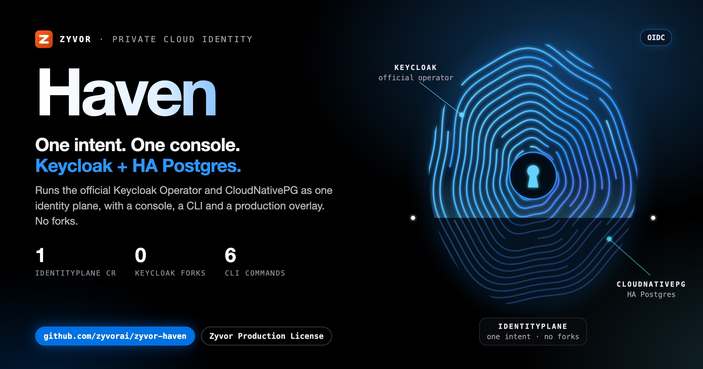
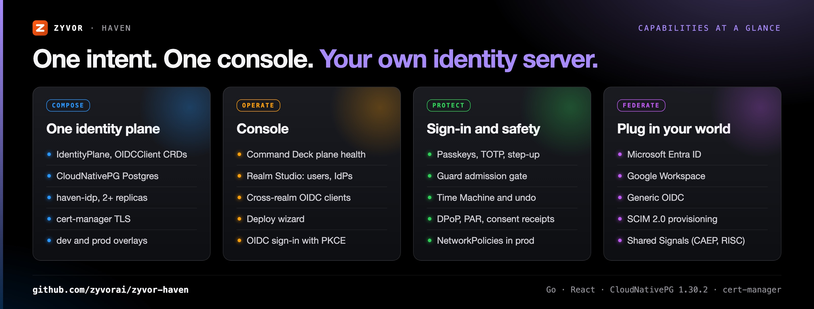
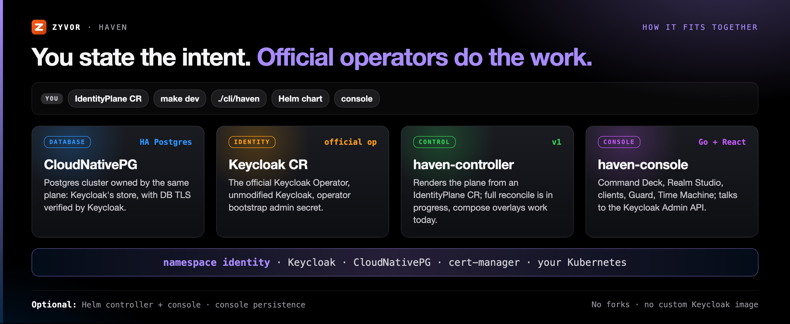

<div align="center">

# Haven

[](https://github.com/zyvorai/zyvor-haven/actions/workflows/ci.yml)
[](LICENSE)
[](go.mod)
[](https://zyvorai.github.io/zyvor-haven/)
[](versions.env)
[](CHANGELOG.md)

[](https://zyvor.dev/schedule?utm_source=github&utm_medium=haven&utm_campaign=readme_hero)
[](https://zyvor.dev/poc?utm_source=github&utm_medium=haven&utm_campaign=readme_hero)
[](#quickstart)



### Identity for the private cloud.

**One intent. One console. Your own OpenID Connect identity server with HA Postgres, built to run on Kubernetes.** `haven-idp` is a small Go identity server with secure defaults. A controller turns one `IdentityPlane` resource into the server, a CloudNativePG database, certificates and ingress.

**Own Go identity server** · **CloudNativePG HA Postgres** · **Passkeys, DPoP, SCIM, MCP-ready** · **One console** · **Zyvor Production Licence**

[Console](docs/console.md) · [Docs](https://zyvorai.github.io/zyvor-haven/) · [Production](#production-overlay) · [License](#license)

</div>

---

## What's in the box

`haven-idp` is built in Go, stores everything in PostgreSQL, and runs as stateless replicas. Dev mode needs no database at all (`haven-idp dev`).

| | |
|---|---|
| **Standards-based core** | Authorization code with PKCE (S256 only), refresh rotation with reuse detection, `client_credentials`, discovery, JWKS with key rotation, introspection and revocation, ES256 tokens, Argon2id passwords |
| **Sign-in your users want** | Passkeys (WebAuthn), TOTP with recovery codes, a "use another method" fallback, risk-based step-up (new device, network change, idle, sensitive scope), email verification, password reset and self-service email change |
| **Sessions and logout** | SSO sessions with idle and absolute limits, RP-initiated and back-channel single logout, `prompt` and `max_age` |
| **Built for CLIs and agents** | Device flow and the `haven` CLI (kubectl plugin included), CIBA for out-of-band human approval, agent identities with delegated `act` tokens, workload identity from Kubernetes service-account tokens, resource indicators (RFC 8707) for MCP |
| **Sender-constrained tokens and FAPI building blocks** | DPoP (RFC 9449), pushed authorization requests, signed request objects, rich authorization requests, per-client "require PAR / DPoP" |
| **Apps register themselves** | `OIDCClient` CRD and Ingress annotations, dynamic client registration (RFC 7591/7592), client ID metadata documents, consent screen with revocable grants and a hash-chained receipt log |
| **Enterprise plumbing** | Federation to Google, Microsoft Entra ID and any OIDC provider, SCIM 2.0 user and group provisioning, Shared Signals (CAEP/RISC) so other systems hear about revoked sessions and compromised credentials |
| **Safe to operate** | Guard blocks risky config changes at the door (off, warn or enforce, with audited overrides), Time Machine recovery points with undo, time-boxed role grants, config as code (`plan`, `apply`, `diff`), Prometheus metrics and an audit stream |
| **Runs where you do** | Kubernetes (controller, Helm, CRDs, NetworkPolicies, Pod Security `restricted`), a single binary on Linux, and macOS with a launchd service and Keychain-backed secrets |

Every feature has its own page in the [docs](https://zyvorai.github.io/zyvor-haven/own-idp-roadmap/), with its security properties and an honest "not yet" list.

### Haven Guard, Time Machine and friends

These work on the identity server's own data, from the console, the API and the `haven-audit` CLI.

| Feature | What it does |
|---|---|
| **Haven Guard** | Deterministic OIDC security posture scoring (23 rules) and drift detection: a live `/api/v1/security/posture` + SARIF API, an offline `haven-audit` CI CLI, and a console Guard page |
| **Time Machine** | Immutable per-realm recovery points with drift diff (clients, users, roles, groups, IdPs, access bindings), safe restore into a new realm, and a previewable undo |
| **Credential Center** | Confidential-client secret inventory, rotation with overlap detection, and explicit retirement, never exposing the previous secret |
| **Federation Hub** | Guided onboarding for upstream identity providers, with secret and certificate redaction on every response |
| **Policy as code** | `haven-audit --policy` evaluates your own declarative rules (no code execution, bounded input, credential paths refused) next to the built-in ones |
| **Access Review** | Privileged and stale account report, break-glass coverage check and recertification campaigns with an append-only decision ledger |
| **Waivers and known-findings gate** | Accepted risks with a reason, approver and expiry; CI fails only on findings that are new since a saved baseline |
| **Realm diff** | `haven-audit diff` compares two realm exports field by field with credential values redacted |



<a id="why-haven"></a>

## Why Haven

Running identity yourself is easy to start and hard to keep safe. Haven makes the safe path the default one.

| When this happens… | Haven gives you… |
|---|---|
| The database is "bring your own": a random StatefulSet, a forgotten RDS URL | A CloudNativePG cluster owned by the same plane |
| Secrets are tribal knowledge, `kubectl create secret` pasted in Slack | Secrets generated, rotated and referenced automatically |
| First boot is a scavenger hunt: find the admin password, guess the hostname, fight TLS | One command, a ready URL and a generated admin secret |
| Day 2 is two UIs and a prayer: kubectl plus an admin console, no backup story | One console: plane health, DB, realms, clients, backups |
| A multi-tenant private cloud runs many undocumented realms | Realms as first-class tenants, with config as code |
| Nobody can say whether the realms are configured safely | Haven Guard posture scoring, drift detection and SARIF for CI |
| An app team wants a client, a CLI wants a login, an AI agent wants delegated access | A CRD, a device flow, agent identities and consent: no tickets |

More: [docs/why-haven.md](docs/why-haven.md).

---

## How it fits together



```text
  you ──► IdentityPlane CR ──► haven-controller
                                   │
                    ┌──────────────┼──────────────┐
                    ▼              ▼              ▼
              CloudNativePG     haven-idp      Certs + Ingress
              (HA Postgres)     (2+ replicas)  (cert-manager)

  haven-console ──► Admin API of haven-idp   ·   haven / haven-audit ──► CLI
```

<table>
<tr>
<td valign="top" width="33%">
<b>IdentityPlane</b><br>
One CR for Postgres + identity server + certs + ingress.<br>
<a href="docs/architecture.md">Architecture</a>
</td>
<td valign="top" width="33%">
<b>OIDCClient</b><br>
Apps get a client and a Secret from a manifest or an Ingress annotation.<br>
<a href="docs/oidcclient-crd.md">OIDCClient CRD</a>
</td>
<td valign="top" width="33%">
<b>Command Deck</b><br>
Live plane health in one glass.<br>
<a href="docs/console.md">Console: routes and auth</a>
</td>
</tr>
<tr>
<td valign="top" width="33%">
<b>Realm Studio</b><br>
Realms, users, clients and IdPs, with Guard in the loop.<br>
<a href="docs/console.md">Console</a>
</td>
<td valign="top" width="33%">
<b>CLI</b><br>
<code>haven</code> for login and tokens, <code>haven-audit</code> for CI, <code>haven-idp</code> for the server.<br>
<a href="docs/cli.md">CLI</a> · <a href="docs/haven-cli.md">haven login</a>
</td>
<td valign="top" width="33%">
<b>Private-cloud defaults</b><br>
NetworkPolicies, Pod Security <code>restricted</code>, TLS and metrics on in <code>production</code>.<br>
<a href="docs/security-posture.md">Security posture</a>
</td>
</tr>
</table>

**Scope:** Haven deploys and operates its identity server and the PostgreSQL cluster behind it (CloudNativePG). It is **not** an AI agent or app-data tool: the Postgres cluster is the identity store, not your app OLTP. Pinned versions: [`versions.env`](versions.env). Design principles: [docs/what-you-get.md](docs/what-you-get.md).

---

<a id="quick-start"></a>

## Quickstart

Just want to try the identity server? No cluster needed:

```bash
go build -o haven-idp ./cmd/haven-idp
./haven-idp dev            # prints an issuer URL, a test user and an admin secret
./haven-idp dev --persist ~/.haven-dev   # keep the data between restarts
```

On Kubernetes:

```bash
git clone https://github.com/zyvorai/zyvor-haven.git
cd zyvor-haven

# 1. Operators (once per cluster): CloudNativePG and cert-manager
./deploy/operators/install.sh

# 2. Postgres + haven-idp
make dev
make wait
make doctor
make admin
```

| | |
|---|---|
| Issuer | `http://auth.127.0.0.1.nip.io/realms/platform` |
| Admin password | `make admin` prints the `kubectl` command to read secret `platform-idp` (key `admin-password`) |

Requirements: a Kubernetes cluster you can install operators into. Pinned versions of CloudNativePG and cert-manager are in [`versions.env`](versions.env). Remote lab console and the local UI: [docs/quick-start.md](docs/quick-start.md). First deploy in depth: [docs/getting-started.md](docs/getting-started.md). Native engine on your own cluster: [docs/deploy-native.md](docs/deploy-native.md). On a Mac: [docs/macos.md](docs/macos.md).

<a id="install-with-helm"></a>

## Install with Helm

```bash
helm install haven oci://ghcr.io/zyvorai/charts/haven --version 0.1.0 \
  --set controller.enabled=true \
  --set console.enabled=true
```

Images: `ghcr.io/zyvorai/haven-console:0.1.0` · `ghcr.io/zyvorai/haven-controller:0.1.0` · `ghcr.io/zyvorai/haven-idp:0.1.0`. Controller and console default to `enabled: false`; chart installs RBAC by default. Details: [docs/install-helm.md](docs/install-helm.md).

<a id="production-overlay"></a>

## Production overlay

`deploy/overlays/prod` is a shape, not a one-liner. Read [docs/production-overlay.md](docs/production-overlay.md) before apply:

1. `./hack/gen-prod-secrets.sh`: do not use the placeholder password (it also generates the key that seals TOTP seeds and federation secrets)
2. Issue `platform-tls` from your ClusterIssuer
3. Configure backups separately ([docs/backups.md](docs/backups.md))

<a id="documentation"></a>

## Documentation

| Doc | When to read |
|---|---|
| [zyvorai.github.io/zyvor-haven](https://zyvorai.github.io/zyvor-haven/) | Product docs |
| [docs/own-idp-roadmap.md](docs/own-idp-roadmap.md) | Every identity-server feature, how far it is tested, and what is not done |
| [docs/faq.md](docs/faq.md) | Deciding whether to adopt |
| [docs/getting-started.md](docs/getting-started.md) | First deploy |
| [docs/troubleshooting.md](docs/troubleshooting.md) | Real operational issues |
| [docs/architecture.md](docs/architecture.md) | CRDs, reconcile order |
| [docs/roadmap.md](docs/roadmap.md) | Scope by version |

Every page, with the design principles: [docs/documentation-map.md](docs/documentation-map.md). Social assets: [docs/social/](docs/social/).

---

## Maturity

> **Maturity (honest):** Haven is young. The identity server, controller and console are implemented and covered by unit, handler and store-conformance tests (the store suite runs against real PostgreSQL), and the native stack has been deployed and exercised end to end on a k3s cluster. Newer features (for example SCIM, Shared Signals, CIBA, PAR/JAR/RAR, consent, agent and workload identities) have been run against the dev binary but not against third-party production systems, and FAPI 2.0 is a set of building blocks, **not** a certified profile. The production overlay is "a shape, not a one-command install." Tagged release: `0.1.0`. Per-feature status and "not yet" lists: [docs/own-idp-roadmap.md](docs/own-idp-roadmap.md) and [docs/roadmap.md](docs/roadmap.md).

| | Status |
|---|---|
| Identity server (`haven-idp`), Admin API, OIDC core, MFA, sessions, federation, SCIM | On `main`, tested; core deployed on k3s |
| Controller, `IdentityPlane`, `OIDCClient`, database NetworkPolicy | On `main`; deployed on k3s |
| Console (Command Deck, Planes, Atlas, Realm Studio, Clients, Settings), console OIDC | On `main` |
| Guard, Time Machine, Credential Center, Federation Hub, Access Review | On `main`, unreleased |
| macOS service and Keychain support | On `main`; unsigned, user LaunchAgent run for real |
| SAML, LDAP, organizations, i18n, mTLS client authentication | Not started |
| Multi-site status, backup restore wizard, Zeus OS Identity Center embed | v2 roadmap |

---

## Part of the Zyvor stack

| Product | Role next to Haven |
|---|---|
| **Haven** | Private-cloud identity: its own identity server + HA Postgres as one plane |
| **[Zorvia](https://github.com/zyvorai/zyvor-zorvia)** | Pairs with Haven on the same private-cloud Kubernetes: KubeVirt VMs next to the identity plane |
| **[Kairo](https://github.com/zyvorai/kairo)** | Pairs with Haven on the same clusters: previews the blast radius of Kubernetes manifest changes before deploy |
| **[Zeus OS](https://zyvor.dev/zeus-os?utm_source=github&utm_medium=haven&utm_campaign=readme_suite)** | An Identity Center embed (shared OIDC session) is on Haven's v2 roadmap |

→ [zyvor.dev](https://zyvor.dev)

---

## Support

A 30-day trial is available on request from sales@zyvor.dev (a paid evaluation Order at no charge); production and any other use needs a paid Order under the Zyvor Production Licence v2.0. If it helps you, you can donate any amount you like: <https://rzp.io/rzp/utwdYh3>. A donation is voluntary and supports development and maintenance. It is not a purchase: it buys no support, SLA, features, priority or license, and it is not tax-deductible (Zyvor AI Labs Private Limited is a company, not a charity). Support contracts are separate: [sales@zyvor.dev](mailto:sales@zyvor.dev).

## License

Haven is source-available under the **[Zyvor Production Licence v2.0](LICENSE)** (SPDX `LicenseRef-Zyvor-Production-2.0`, also in [LICENSES/](LICENSES/LicenseRef-Zyvor-Production-2.0.txt); see [NOTICE](NOTICE)).

- **Trial:** a 30-day trial is available on request from [sales@zyvor.dev](mailto:sales@zyvor.dev) (a paid evaluation Order at no charge).
- **Production and any other use needs a paid Order** under the Zyvor Production Licence v2.0. Buy / get a quote: [zyvor.dev/buy](https://zyvor.dev/buy) · [sales@zyvor.dev](mailto:sales@zyvor.dev).
- **Price:** INR 118,999 per deployment per year incl. 18% GST in India; US$1,201 per deployment per year excl. tax elsewhere. Buy: [zyvor.dev/buy](https://zyvor.dev/buy). Orders of USD 5,000 or more and quotes are invoiced in USD through Skydo.

**Zyvor Enterprise** adds what production teams ask for: supported releases, deployment and upgrade guidance, priority incident triage, a named technical contact and 24x7 critical intake. Production support, SLAs, and Zyvor Enterprise products are licensed separately. Plans and terms: [docs/SUBSCRIPTION-MODEL.md](docs/SUBSCRIPTION-MODEL.md) · [Pricing](https://zyvor.dev/pricing?utm_source=github&utm_medium=haven&utm_campaign=readme_license) · [Buy / get a quote](https://zyvor.dev/buy) · [sales@zyvor.dev](mailto:sales@zyvor.dev).

Contributions: [CONTRIBUTING.md](CONTRIBUTING.md). Report vulnerabilities privately per [SECURITY.md](SECURITY.md).

---

<div align="center">

### Run identity your private cloud can depend on

[](https://zyvor.dev/schedule?utm_source=github&utm_medium=haven&utm_campaign=readme_footer)
[](https://zyvor.dev/poc?utm_source=github&utm_medium=haven&utm_campaign=readme_footer)
[](https://zyvor.dev/pricing?utm_source=github&utm_medium=haven&utm_campaign=readme_footer)
[](mailto:sales@zyvor.dev?subject=Haven)
[](https://github.com/zyvorai/zyvor-haven)

</div>
