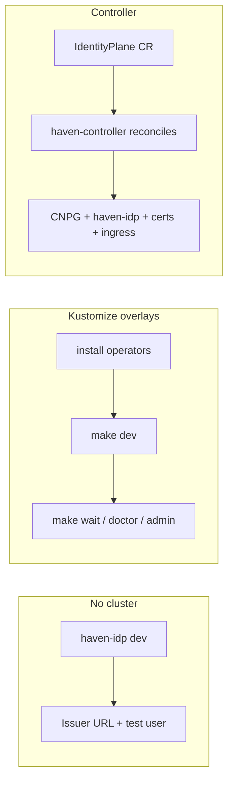

---
hero:
  eyebrow: IDENTITY PLANE
  title: Haven
  lead: >-
    Your own OpenID Connect identity server with HA PostgreSQL, run as one
    product on Kubernetes: one intent object, one console, secure defaults.
  swatches:
    - {label: "haven-idp (Go OIDC server)"}
    - {label: "CloudNativePG 1.30.2"}
    - {label: "Zyvor Production Licence"}
  highlights:
    - {value: "v0.1.0", label: "Only tagged release today. Newer features are tested but young", footnote: "1"}
    - {value: "2", label: "Active custom resources: IdentityPlane and OIDCClient", footnote: "2"}
    - {value: "23", label: "Deterministic security rules Haven Guard checks (HAVEN001–023)", footnote: "3"}
    - {value: "5", label: "CLI commands: deploy, status, doctor, admin, backup", footnote: "4"}
  hub_bands:
    - {icon: "❓", title: "FAQ", description: "Decide whether Haven fits my use case.", href: "faq.md"}
    - {icon: "🚀", title: "Getting started", description: "Run haven-idp with no cluster, or deploy a plane with Postgres on Kubernetes.", href: "getting-started.md"}
    - {icon: "📘", title: "Runbook", description: "Install operators, deployment paths, day-2 ops, failure cheatsheet.", href: "runbook.md"}
    - {icon: "🖥️", title: "Console", description: "Sign in, change passwords, wire OIDC.", href: "console.md"}
    - {icon: "🧩", title: "Architecture", description: "CRDs, reconcile order, profiles, trust model.", href: "architecture.md"}
footnotes:
  - {marker: "1", text: "The README states one tagged release, 0.1.0. Per-feature status and the honest not-yet lists are in the identity-server status table.", href: "own-idp-roadmap.md", href_label: "See the status table."}
  - {marker: "2", text: "IdentityPlane and OIDCClient are the two custom resources the controller reconciles; the controller builds the database, identity server, certificates and ingress from one IdentityPlane.", href: "architecture.md", href_label: "See Architecture."}
  - {marker: "3", text: "Haven Guard's rule table lists HAVEN001 through HAVEN030 across critical/high/medium/low severity.", href: "security-posture.md", href_label: "See Security posture."}
  - {marker: "4", text: "The CLI (./cli/haven) and Makefile targets cover deploy, status, doctor, admin, and backup.", href: "cli.md", href_label: "See CLI."}
---

Haven is a private-cloud identity product: its own Go OIDC identity server, `haven-idp`, with an HA PostgreSQL database managed by CloudNativePG, deployed and operated as one plane. These docs cover how to deploy it, operate it day-to-day, and how the pieces fit together. Coming from another identity server? See [Migrate from Keycloak](migrate-from-keycloak.md).

**Published site:** [zyvorai.github.io/zyvor-haven](https://zyvorai.github.io/zyvor-haven/) · **Preview locally:** `make docs-serve`

> **Convention:** run every command from the Haven repo root (the directory that contains `Makefile`, `cli/haven`, and `scripts/`).

## The custom resources

- **IdentityPlane**
  The root object. One plane is one `haven-idp` Deployment + one PostgreSQL cluster + how the world reaches them: profile, database, identity-server replicas and resources, exposure, and the bootstrap realm all live here.
- **OIDCClient**
  An app registration that belongs to a realm. The controller creates the client in `haven-idp` and writes a Secret the workload can mount (`client-id`, `client-secret`, `issuer`). See [OIDCClient CRD](oidcclient-crd.md).
- **Realms as code**
  Realm settings, roles and groups are declared in a YAML file and applied with `haven-idp plan` / `apply`, with Guard in the loop. See [Config as code](config-as-code.md).

---

## Documentation map

### Operations

| Doc | Contents |
|---|---|
| [Getting started](getting-started.md) | Choose a deployment path (no cluster, dev, production) |
| [Runbook](runbook.md) | Install operators, deployment paths, day-2 ops, failure cheatsheet |
| [Lab host](lab-host.md) | Notes on the shared lab machine and OIDC wiring |
| [Console](console.md) | Routes, auth modes, local UI dev |
| [Tutorials](tutorials.md) | Console recipes: realms, clients, passwords |
| [CLI](cli.md) | `./cli/haven` commands and Makefile targets |

### Design

| Doc | Contents |
|---|---|
| [Architecture](architecture.md) | CRDs, reconcile order, profiles, trust model |
| [UX](ux.md) | Command Deck, deploy wizard, visual language |
| [Private cloud](private-cloud.md) | Zeus OS mapping, platform SSO catalog, tenancy |
| [Roadmap](roadmap.md) | What is built, what is next |

### Deploy overlays (in-tree)

| Path | Contents |
|---|---|
| [production-overlay.md](production-overlay.md) | Production prerequisites: secrets, TLS, backups |
| [backups.md](backups.md) | Backup object store setup |

---

## Deployment paths at a glance

| Path | Status | Entry point |
|---|---|---|
| **Try it, no cluster** | Supported | `go build -o haven-idp ./cmd/haven-idp && ./haven-idp dev` |
| **Dev overlay** | Supported | `make dev`: see [runbook Path B](runbook.md#path-b) |
| **IdentityPlane CR + controller** | Deployed on k3s | [deploy-native.md](deploy-native.md) |
| **Production overlay** | Shape only | [production-overlay.md](production-overlay.md) |

---

## External references

- [Haven manual](https://zyvor.dev/docs/haven-manual) — user-facing docs on zyvor.dev
- [Common workflows](https://zyvor.dev/docs/haven-manual/workflows)
- [Page-by-page guides](https://zyvor.dev/docs/haven-manual/pages)
- [Contributing](contributing.md) — dev setup, doc conventions, PRs
